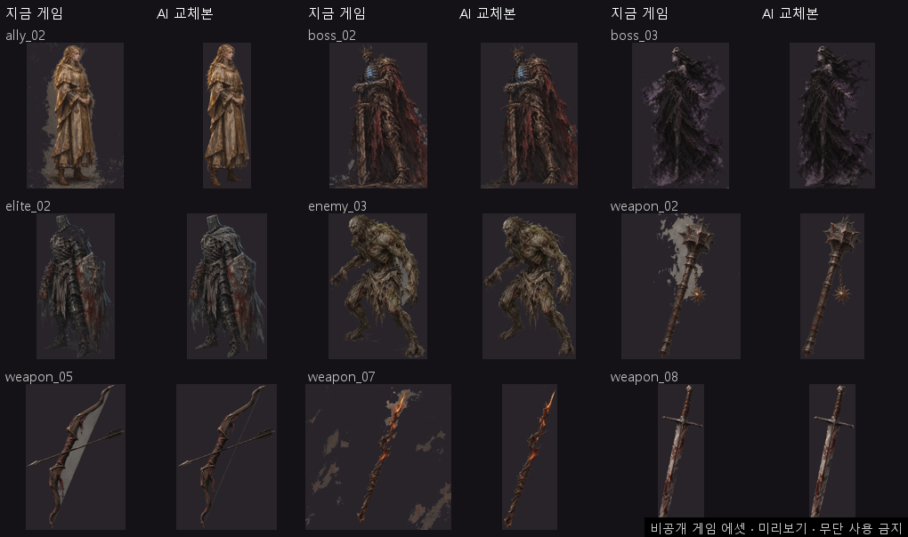
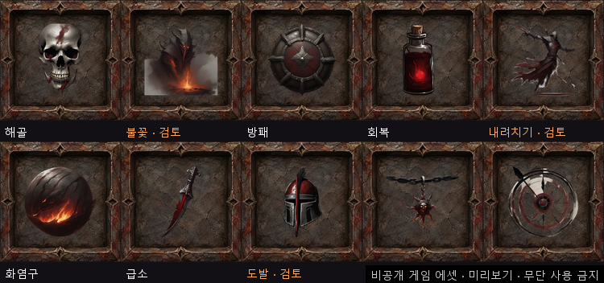

# 게임 그림 작업에 AI 넣기: 배경 제거 품질 검사 + 아이콘 생성 PoC

> AIFFEL 메인퀘스트 2 · 내 도메인에서 AI로 개선 지점 찾아서 PoC 만들기

혼자 만들고 있는 **출시 예정 모바일 다크 판타지 게임**의 그림 작업에서 병목 두 곳에 로컬 AI 모델을 넣어 보았습니다.

| | 하는 일 | 레슨의 업무 유형 | 쓴 모델 | 결론 |
|---|---|---|---|---|
| **A** | 게임에 이미 들어간 배경 제거 그림의 **결함 찾기 + 다시 만들기** | 검사·판독 | BiRefNet (분할) | **도입**: 31장 중 결함 10장 발견, 9장 교체 |
| **B** | 아직 없는 **아이콘 10개 생성** | 생성 (네 유형 밖) | SDXL (Diffusion) + SigLIP 2 + BiRefNet | **보류**: 알아볼 수는 있지만 화풍이 게임과 안 맞음 |

> **공개 범위**: 출시 전 게임이라 게임 제목, 기획 내용, 생성 프롬프트, 원본 그림은 올리지 않았습니다.
> 그림은 작게 줄이고 표시를 넣은 미리보기만 있고, 그림 이름은 `boss_01`처럼 바꿨습니다.
> 코드, 문서, 모든 측정 숫자(CSV)는 그대로 있습니다.

## 결과 한눈에 보기

### A. AI가 찾아낸 기존 그림의 결함, 그리고 AI로 다시 만든 것



- 배경 제거 결과를 사람이 대충 보고 넘겨서 **31장 중 10장에 결함**(배경 얼룩, 활시위 안 배경, 뜯긴 칼날 등)이 있었습니다.
- AI 결과와의 차이(IoU)에 **임계값 0.93**을 걸면 결함 10장을 모두 잡고, 사람은 31장 대신 **16장**만 보면 됩니다.
- 배경 제거 성능: BiRefNet IoU **0.942**, AI 없는 색 지우기 기준선은 0.875입니다 (결함 없는 21장 기준). 목표 0.95에는 못 미쳤습니다.

### B. 로컬에서 만든 아이콘 (SDXL, 게임 칸 위에 올린 모습)



- 10개 중 **8개는 알아볼 수 있고** 게임에 쓸 수 있습니다. 자동 채택한 7개는 모두 쓸 수 있었습니다.
- SigLIP 2의 확신이 낮은 3개는 **자동으로 사람 검토로 넘겼고**, 그중 2개(불꽃, 내려치기)는 실제 불량이었습니다.
- 아이콘 1개당 기계 시간은 약 1분 45초이고, **같은 시드로 다시 만들면 픽셀까지 같은 그림**이 나옵니다.
- 하지만 **화풍이 게임 그림만큼 맞지 않아서** 생성은 지금처럼 ChatGPT를 쓰고, 배경 제거와 검사만 이 파이프라인으로 바꾸기로 했습니다.

## 성공 기준 결과

| # | 기준 | 목표 | 결과 | |
|---|---|---|---|---|
| ① | 배경 제거 IoU | 0.95 | 0.942 (기준선 0.875) | 미달 |
| ② | 알아볼 수 있는 아이콘 | 8 / 10 | 8 / 10 | 통과 |
| ③ | 화풍이 기존 그림만큼 비슷함 | 10 / 10 | 3 / 10 | 미달 |
| ④ | 자동 채택 아이콘의 사람 조작 | 0회 | 7개 0회, 3개 검토 | 부분 |
| ⑤ | 아이콘 1개 기계 시간 | 3분 이하 | 약 1분 45초 | 통과 |
| ⑥ | 재현성 | 픽셀 차이 0 | 0 | 통과 |
| 추가 | 품질 검사기 결함 재현율 | 100% | 100% (16 / 31장만 검토) | 통과 |

## 문서

| 문서 | 내용 |
|---|---|
| [docs/01_problem_definition.md](docs/01_problem_definition.md) | 도메인, 현재 문제, 업무 유형, 개선 가설, 대상 사용자, 성공 기준 |
| [docs/02_model_selection.md](docs/02_model_selection.md) | 후보 모델, 라이선스로 먼저 거르기, 내 자료로 비교, 선정 이유 |
| [docs/03_evaluation.md](docs/03_evaluation.md) | 기존 방식과 비교, 임계값 표, 실패 사례, 한계와 다음 단계 |

## 파이프라인

```
A. 품질 검사
   원본 그림 ──▶ BiRefNet 배경 제거 ──▶ 게임 배경 제거본과 IoU ──▶ 0.93 미만이면 "검토 필요"
                                                                 └▶ 사람 확인 ──▶ AI 교체본 저장

B. 아이콘
   아이콘 이름 + (비공개) 프롬프트 ──▶ SDXL, 시드 4개 ──▶ SigLIP 2 한국어 10지선다
        ──▶ 확신 0.5 이상: 자동 채택 / 아래: 검토 필요 ──▶ BiRefNet 배경 제거 ──▶ 256×256 투명 PNG
```

모든 모델은 노트북(RTX 5060 Laptop 8GB)에서 돌렸고, 그림을 외부로 보내지 않았습니다.

## 폴더 구성

```
src/
  bg_remove.py     배경 제거 방법 4가지 (색 지우기 기준선, U²-Net, IS-Net, BiRefNet)
  eval_bg.py       게임 배경 제거본과 비교 (위치 맞추기 → IoU, MAE)
  qa_cuts.py       품질 검사기: 판정용 비교표, 임계값별 정밀도·재현율
  fix_cuts.py      결함 그림을 AI로 다시 만들기
  gen_icons.py     아이콘 생성 (SDXL / SDXL + IP-Adapter, 시드 고정)
  eval_icons.py    SigLIP 2 채점 (알아볼 수 있는가, 화풍 유사도)
  make_icons.py    시드 고르기 (확신 낮으면 검토) → 배경 제거 → 게임용 PNG
tools/public_assets.py   공개용 미리보기 만들기 (축소, 이름 바꾸기, 표시)
data/
  icons.json              아이콘 10개 이름
  prompts.example.json    프롬프트 파일 형식 (실제 프롬프트는 비공개)
outputs/                  측정 결과 CSV와 공개용 미리보기 그림
```

## 실행 방법

### 1) 환경 (Windows, NVIDIA GPU)

```bash
python -m venv .venv
```

```bash
.venv/Scripts/pip install torch==2.11.0 torchvision==0.26.0 --index-url https://download.pytorch.org/whl/cu128
```

```bash
.venv/Scripts/pip install -r requirements.txt
```

처음 실행할 때 모델을 내려받습니다 (SDXL 약 7GB, IP-Adapter 약 3GB, BiRefNet 약 1GB, SigLIP 2 약 1.5GB).

### 2) 내 자료 넣기

원본 그림과 프롬프트는 비공개라 저장소에 없습니다. 같은 파이프라인을 내 그림으로 돌리려면 아래처럼 넣습니다.

| 자료 | 위치 |
|---|---|
| 원본 그림 / 지금 쓰는 배경 제거본 (같은 이름) | `data/game_art/original/*.webp`, `data/game_art/cut/*.webp` |
| 화풍 기준 그림, 기존 아이템 그림 | `data/style_ref/*.webp` (기준 그림 이름: `master_style_A.webp`) |
| 게임 칸 틀 그림 | `data/game_ui_slot.webp` |
| 프롬프트 | `data/prompts.example.json`을 `data/prompts.private.json`으로 복사해 채우기 |

### 3) 실행

```bash
.venv/Scripts/python src/eval_bg.py
```

```bash
.venv/Scripts/python src/qa_cuts.py alphas
```

```bash
.venv/Scripts/python src/qa_cuts.py sheets
```

`outputs/qa/label_sheets/`를 보고 `data/game_art/qa_labels.json`에 판정을 적은 뒤 실행합니다.

```bash
.venv/Scripts/python src/qa_cuts.py report
```

```bash
.venv/Scripts/python src/fix_cuts.py
```

```bash
.venv/Scripts/python src/gen_icons.py --candidate sdxl
```

```bash
.venv/Scripts/python src/gen_icons.py --candidate sdxl_ipa
```

```bash
.venv/Scripts/python src/eval_icons.py
```

```bash
.venv/Scripts/python src/make_icons.py --candidate sdxl
```

판정 기준, 임계값, 시드, 생성 설정은 모두 명령 인자로 바꿀 수 있습니다 (`--help`). 생성한 그림과 AI 알파는 이미 있으면 덮어쓰지 않습니다.

## 라이선스 확인 (2026-11-17)

SDXL base: OpenRAIL++-M · IP-Adapter: Apache-2.0 · BiRefNet: MIT · SigLIP 2: Apache-2.0 · rembg: MIT
FLUX.1-dev와 SDXL-Turbo는 비상업 라이선스라 후보에서 뺐습니다 (게임에 결제·광고가 있음).

## 이 저장소의 그림에 대해

`outputs/public/`의 그림은 출시 예정 게임의 에셋 미리보기입니다. 과제 확인 용도로만 올렸으며, 다른 용도로 쓰거나 다시 배포하지 말아 주세요.
