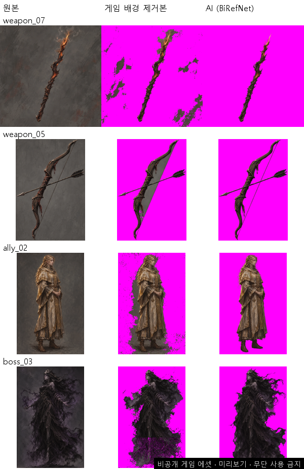
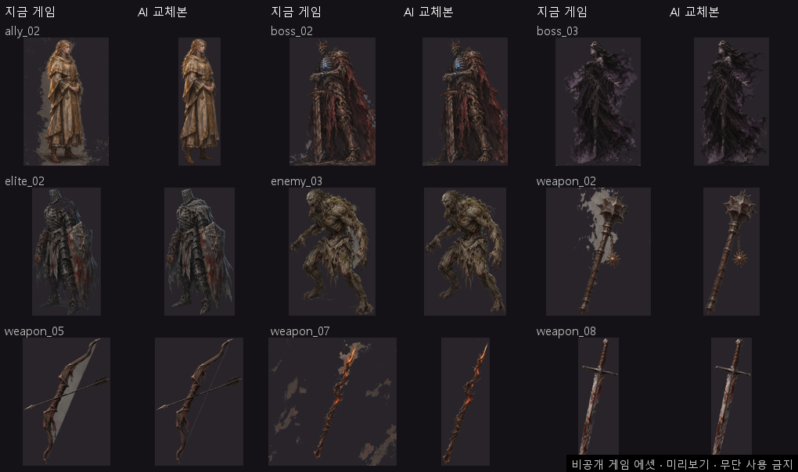
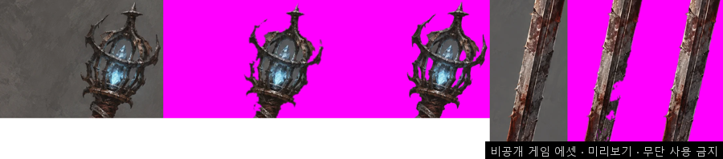
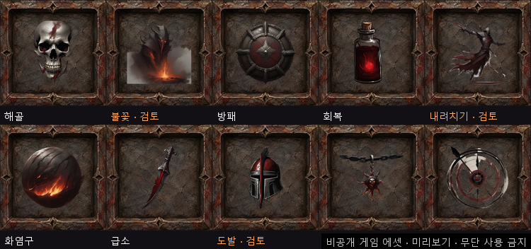
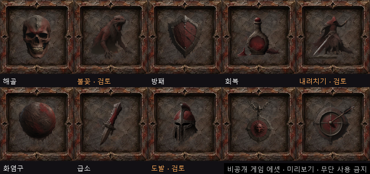

# 3. 개선 효과 검증

> 그림은 출시 전 게임 에셋이라 작게 줄인 미리보기만 싣는다. 그림 이름은 바꿔 적었다 (`boss_01` 등).
> 판정은 Claude가 1차로 하고 개발자가 확인했다. 숫자는 모두 `outputs/` 의 CSV에서 다시 확인할 수 있다.

## 결과 요약

| # | 성공 기준 | 목표 | 결과 | 판정 |
|---|---|---|---|---|
| ① | 배경 제거 IoU 평균, 기준선보다 높음 | 0.95 이상 | 결함 없는 21장 **0.942** (기준선 0.875) / 31장 전체 0.872 | **미달** (기준선보다는 높음) |
| ② | 알아볼 수 있는 아이콘 | 10종 중 8종 | SigLIP **8종**, 사람 판정 **8종** | **통과** |
| ③ | 화풍이 기존 그림만큼 비슷함 | 10개 모두 | **3개** (SDXL) / 5개 (IP-Adapter) | **미달** |
| ④ | 자동 채택 아이콘의 사람 조작 | 0회 | 7개는 **0회**, 3개는 검토로 넘어감 | 부분 통과 |
| ⑤ | 아이콘 1개 기계 시간 | 3분 이하 | **약 1분 45초** (생성 4장 89초 + 배경 제거 16초) | **통과** |
| ⑥ | 재현성 | 픽셀 차이 0 | **0** (같은 시드로 다시 생성, 최대 차이 0) | **통과** |
| 추가 | 품질 검사기: 결함을 모두 잡으면서 검토량 절반 가까이 | 재현율 100% | 임계값 0.93에서 **10장 모두 잡고 31장 중 16장만 검토** | **통과** (사후 추가 기준) |

### 결론: 무엇을 도입하고 무엇을 보류하나

| 부분 | 결정 | 근거 |
|---|---|---|
| **배경 제거 + 품질 검사 (A)** | **도입** | 기존 결과물에서 결함 10장을 찾아냈고, 9장은 AI 결과로 바로 교체할 수 있었다. 기준선(색 지우기)보다 IoU가 확실히 높다 |
| **아이콘 생성 (B)** | **보류** — 생성은 지금처럼 ChatGPT로 하고, 배경 제거와 검사만 이 파이프라인을 쓴다 | 알아볼 수 있는 아이콘은 만들지만 화풍이 게임과 맞지 않는다 (③ 미달). 한 장이 바로 나올 때의 시간도 ChatGPT(1분 이내)가 더 빠르다 |

---

## A. 배경 제거와 품질 검사 (검사·판독)

### A-1. 정답이라고 생각한 자료에 결함이 있었다

처음에는 게임에 쓰고 있는 배경 제거본 31장을 정답으로 놓고 AI 결과를 채점했다. 그런데 **모든 방법이 같은 그림에서 함께 낮은 점수**를 받았다. 확인해 보니 정답 쪽이 틀려 있었다.

그래서 31장 전체를 **점수를 가리고 순서를 섞은 비교표**(원본 | 게임 배경 제거본 | AI)로 다시 판정했다. 판정 기준은 다음과 같다.

- **결함**: 눈에 띄는 배경 조각이 남았거나 대상 일부가 지워짐
- **경미**: 발밑에 옅은 그림자나 작은 조각만 남음

| 판정 | 장수 | 예 |
|---|---|---|
| 결함 | **10** | weapon_07 배경 얼룩 덩어리, weapon_05 활시위 안쪽 삼각형, ally_02 몸 둘레 배경 테두리, elite_02 다리가 반투명하게 지워짐, weapon_08 칼날 가운데가 뜯겨 나감 |
| 경미 | 8 | 발밑 그림자 (enemy_02, enemy_05, elite_01 등) |
| 결함 없음 | 13 | |

> **판정도 틀릴 수 있었다.** weapon_08(칼날이 뜯겨 나감)은 작은 비교표에서는 놓쳤다가, 실패 분석 중 확대해서 찾아 고쳤다. 판정은 확대해서 해야 한다.

### A-2. 배경 제거 방법 비교

| 방법 | 31장 IoU 평균 | 결함 없는 21장 IoU 평균 | 21장 중 0.95 이상 | 장당 시간 (CPU) |
|---|---|---|---|---|
| 기준선: 색 지우기 | 0.788 | 0.875 | 3 | 0.13초 |
| U²-Net | 0.864 | 0.937 | 13 | 0.64초 |
| IS-Net | 0.869 | 0.940 | 13 | 1.51초 |
| **BiRefNet** | **0.872** | **0.942** | 13 | 15.8초 |

**성공 기준 ①(0.95)은 넘지 못했다.** 그 이유는 실패 분석(A-5)에 있다.

### A-3. 품질 검사기: 임계값 정하기

게임 배경 제거본과 AI 결과의 IoU가 낮으면 둘 중 하나가 틀렸다는 뜻이다. 그래서 IoU에 임계값을 걸어 "검토 필요"를 표시했다. 레슨의 임계값 구간과 같은 방식으로, 임계값을 올려 가며 결함을 몇 장 잡는지와 사람이 몇 장을 봐야 하는지를 쟀다.

| 임계값 | 검토 필요로 표시 | 잡은 결함 (10장 중) | 결함 아닌데 표시 | 정밀도 |
|---|---|---|---|---|
| 0.80 | 6 | 6 | 0 | 1.00 |
| 0.90 | 11 | 8 | 3 | 0.73 |
| 0.92 | 13 | 9 | 4 | 0.69 |
| **0.93** | **16** | **10** | 6 | 0.63 |
| 0.95 | 18 | 10 | 8 | 0.56 |

- **임계값 0.93**: 결함 10장을 모두 잡고, 사람은 31장 대신 **16장**만 보면 된다.
- 결함이 아닌데 표시된 6장 중 4장은 "경미"(발밑 그림자) 판정이다. 사람이 볼 만한 그림이 대부분이다.
- 레슨 원칙대로 최종 판정은 사람에게 남긴다. AI는 볼 그림을 좁히는 역할만 한다.

### A-4. 결함 교체본

결함 10장 중 AI 결과가 깨끗한 9장을 AI로 다시 만들었다. 게임의 배경 제거본과 같은 형식(대상 둘레를 잘라 높이 900px)이다.

남은 1장(boss_01)은 AI가 손과 머리의 보라색 마법 불꽃까지 지워서 교체하지 않았다. 사람이 손봐야 한다.

### A-5. 실패 분석: 결함이 없는 그림에서도 0.95를 못 넘은 이유

결함 없는 21장 중 8장이 0.95 아래였다. 차이가 난 곳은 세 종류다.

| 유형 | 내용 | 해당 |
|---|---|---|
| **발밑 그림자** | 게임 배경 제거본은 발밑의 옅은 그림자를 남겼고, AI는 지웠다. 어느 쪽이 맞는지는 **설계 선택**이다 | enemy_02, enemy_05, elite_01, player_05 |
| **빛·마법 효과** | AI는 대상에서 나오는 빛이나 연기를 배경으로 보고 지운다 | boss_01 (마법 불꽃), weapon_07 (불꽃 끝의 연기) |
| **가는 경계** | 머리카락, 너덜너덜한 옷자락 끝에서 1~2픽셀씩 어긋난다 | player 그림 대부분 |

> 0.95라는 기준은 "발밑 그림자를 남길지"를 정하지 않은 채로 세운 숫자였다. 그림자 규칙을 먼저 정하고(예: 남기지 않는다) 정답을 그 규칙에 맞춰 다시 만들어야 0.95를 공정하게 잴 수 있다.

---

## B. 아이콘 생성

### B-1. 기존 방식과 나란히 비교

| 항목 | 지금 방식: ChatGPT | PoC: 로컬 SDXL 파이프라인 |
|---|---|---|
| 한 장이 바로 나올 때 | 사람이 붙어서 **1분 이내** (개발자 기록) | 기계 **약 1분 45초**, 사람 0분 (4장 생성 + 자동 선별 + 배경 제거) |
| 실패했을 때 | 프롬프트 고쳐 다시 생성, **약 5분** (개발자 기록, 2건) | 실패 3개가 **자동으로 검토로 넘어옴**. 고치려면 프롬프트를 바꿔 다시 돌려야 하는 것은 같다 |
| 10개 만들기 | 사람이 10번 반복 | 명령 한 번, 약 18분 (사람은 다른 일 가능) |
| 다시 만들기 | 불가능 (시드 없음) | **같은 그림** (픽셀 차이 0) |
| 배경 제거 | 따로 작업, 결함 검사 없음 | 파이프라인 안에서 BiRefNet으로 자동 |
| 화풍 | 기준 그림 첨부로 **잘 맞음** (게임 그림 전체가 이 방식) | **덜 맞음** (③ 미달) |
| 그림이 외부로 나감 | 나감 | 안 나감 |

> ChatGPT 쪽 시간은 따로 재지 않고 개발자의 작업 기록에서 가져왔다. 같은 아이콘으로 나란히 잰 값이 아니라는 점이 이 비교의 한계다.

### B-2. 후보별 결과

| 아이콘 | SDXL: SigLIP 정답 (4장 중) | SDXL: 자동 채택 | SDXL: 사람 판정 | IP-Adapter: 사람 판정 |
|---|---|---|---|---|
| 해골 | 4 | O | O | O |
| 불꽃 | 0 | 검토 | **X** 불길 대신 괴물 + 배경 제거 실패 | X 괴물 |
| 방패 | 4 | O | O | O |
| 회복 | 4 | O | O | O |
| 내려치기 | 1 | 검토 | **X** 아이콘이 아니라 전사 전신 | X 전사 전신 |
| 화염구 | 4 | O | O | **X 불꽃이 사라짐** |
| 급소 | 4 | O | O | O |
| 도발 | 0 | 검토 | O (투구. SigLIP이 방패로 오판) | O |
| 축복 | 3 | O | O | O |
| 조준 사격 | 3 | O | O | O |

**"확신이 낮으면 사람에게" 규칙의 성적 (SDXL)**

| | 사람 판정 O | 사람 판정 X |
|---|---|---|
| 자동 채택 (7) | **7** | 0 |
| 검토로 넘김 (3) | 1 (도발) | **2** (불꽃, 내려치기) |

규칙의 기준(정답 이름 확률 0.5 이상)은 결과를 보기 전에 정했다. 나쁜 아이콘을 자동으로 채택한 경우는 없었다.

### B-3. 화풍 (③ 미달)

| | 화풍 유사도 (SigLIP 임베딩 코사인) |
|---|---|
| 기준선: ChatGPT 아이템 그림 9장끼리 | 평균 0.877, **최저 0.809** |
| SDXL 최종 10개 | 평균 0.796, 기준 이상 3개 |
| IP-Adapter 최종 10개 | 평균 0.826, 기준 이상 5개 |

SDXL 아이콘은 대비가 강하고 바탕이 하얗게 번지는 "디지털 일러스트" 느낌이 난다. 게임 그림의 거친 유화 질감과 다르다. IP-Adapter는 질감을 맞추지만 색까지 기준 그림처럼 붉게 바꿔 버린다.

---

## 실패 사례와 원인

| 실패 | 원인 추정 | 다음에 바꿀 것 |
|---|---|---|
| 불꽃 아이콘이 괴물로 나옴 (두 후보 모두) | "불길의 혀(tongue of flame)" 같은 비유 표현을 모델이 생물로 해석 | 비유 대신 모양을 직접 묘사 ("a single campfire flame, teardrop shape") |
| 내려치기가 전사 전신으로 나옴 | 동작을 요청하면 그 동작을 하는 사람을 그림 | 동작 대신 물체만 ("a greatsword with a motion arc, no person") |
| **프롬프트 뒷부분이 잘림** | SDXL 텍스트 인코더의 한도는 77토큰인데 프롬프트가 102토큰. 뒤쪽의 "단색 회색 배경, 글자 없음" 조건이 무시됨 | 프롬프트를 77토큰 안으로 줄이거나, 긴 프롬프트를 나눠 넣는 방식 사용 |
| 불꽃 아이콘의 배경이 네모로 남음 | 연기가 화면 전체에 퍼져 BiRefNet이 대상과 배경을 나누지 못함 | 생성 단계에서 단색 배경을 강제 (위 77토큰 문제를 고치면 함께 나아질 것) |
| IP-Adapter가 색까지 바꿈 | 기준 그림이 붉은 갈색 인물이라 색이 화풍과 함께 따라옴 | 화풍 참조를 아이템 그림(무기 아이콘)으로 바꾸거나 참조 세기를 낮춤 (0.8 → 0.4~0.6) |
| SigLIP 오판 (투구 → 방패, 불꽃 없는 공 → 화염구) | 한국어 이름 하나로 판정. 모양이 비슷한 물체를 구분하지 못함 | 이름을 더 구체적으로 ("붉은 깃털 장식 투구"), 자동 판정은 검토 대상 좁히기에만 사용 |
| 배경 제거가 빛·연기를 지움 | 대상 분할 모델은 빛을 "대상"으로 보지 않음 | 효과가 있는 그림은 검토 필요로 넘기는 규칙 추가 |

## 재현 방법

- 배경 제거 비교, 품질 검사기: `src/eval_bg.py`, `src/qa_cuts.py` (원본 그림이 필요함. 원본은 비공개)
- 아이콘: `src/gen_icons.py` → `src/eval_icons.py` → `src/make_icons.py` (비공개 프롬프트 파일이 필요함. 형식은 `data/prompts.example.json`)
- 결과 숫자: `outputs/*.csv`, `outputs/bg_eval/*.csv`, `outputs/qa/*.csv`
- 생성 설정: steps 30, guidance 6.0, 1024×1024, 시드 0~3, IP-Adapter 세기 0.8, RTX 5060 Laptop GPU (8GB)

## 한계와 다음 단계

**한계**
- 판정은 Claude의 1차 육안 판정을 개발자가 확인한 것이다. 사람 한 명의 판정이라 일관성을 따로 재지 않았다.
- 화풍 유사도는 SigLIP 임베딩 거리라서 "내용"의 차이도 섞여 있다. 무기 그림과 해골 아이콘은 화풍이 같아도 거리가 멀 수 있다.
- ChatGPT 쪽 시간은 개발자 기록이다. 같은 아이콘으로 나란히 재지 않았다.
- 배경 제거의 0.95 기준은 그림자 규칙을 정하지 않은 채로 세운 숫자다.

**다음 단계 (도입 제안)**
1. **바로 도입**: 결함 교체본 9장을 게임에 넣는다. 앞으로 그림을 추가할 때마다 품질 검사기(임계값 0.93)를 돌린다.
2. **배경 제거 규칙 정하기**: 발밑 그림자를 남길지 정하고, 그 규칙으로 정답을 다시 만들어 0.95를 다시 잰다.
3. **아이콘 생성 재시도**: 프롬프트를 77토큰 안으로 줄이고 비유 표현을 없앤 뒤, 화풍 참조를 기존 아이템 그림으로 바꿔 ③을 다시 잰다.
4. **파인튜닝**: 게임 그림 약 80장으로 SDXL LoRA를 학습해 화풍을 모델에 넣는다. 화풍 문제를 근본적으로 푸는 방법이다.
5. **비용**: 모두 내 노트북(RTX 5060 8GB)에서 돌아서 추가 비용이 없다. 모델 내려받기는 약 12GB다.
